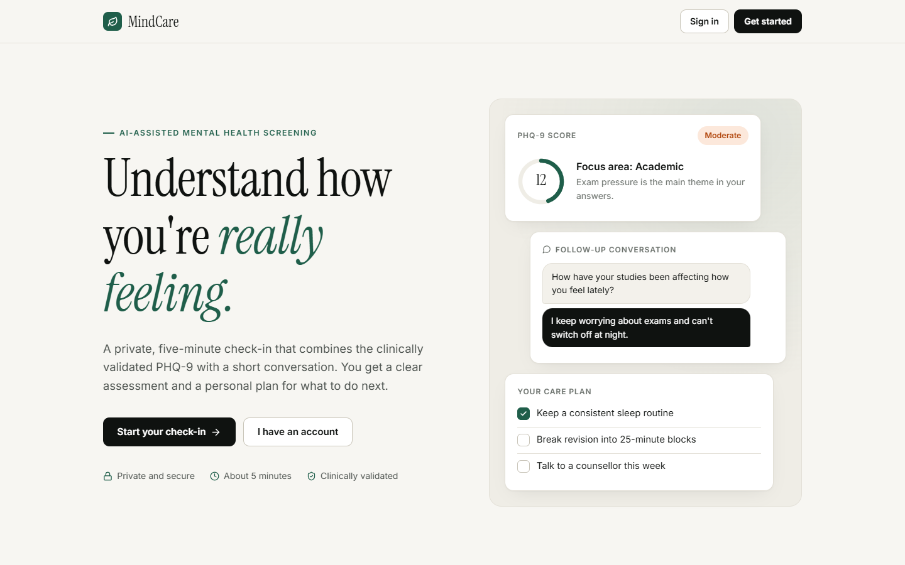
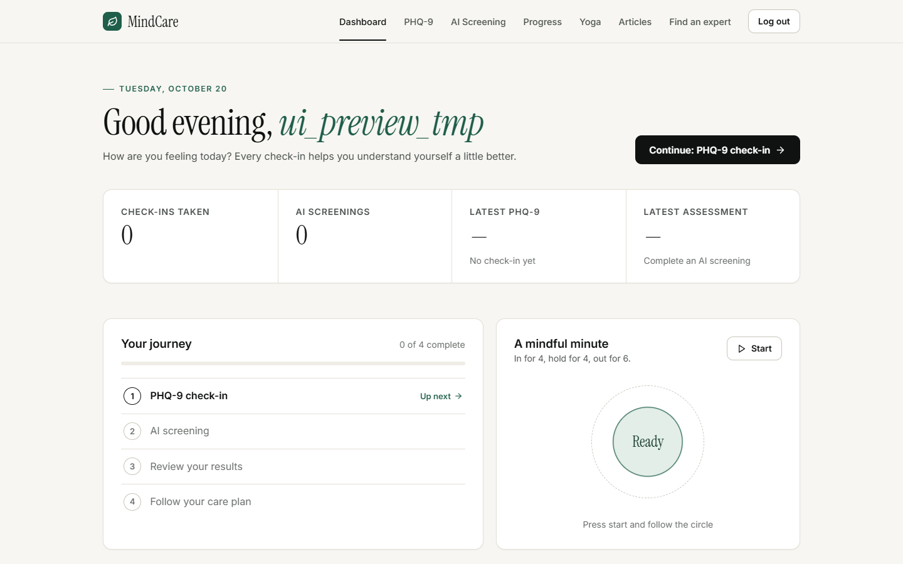
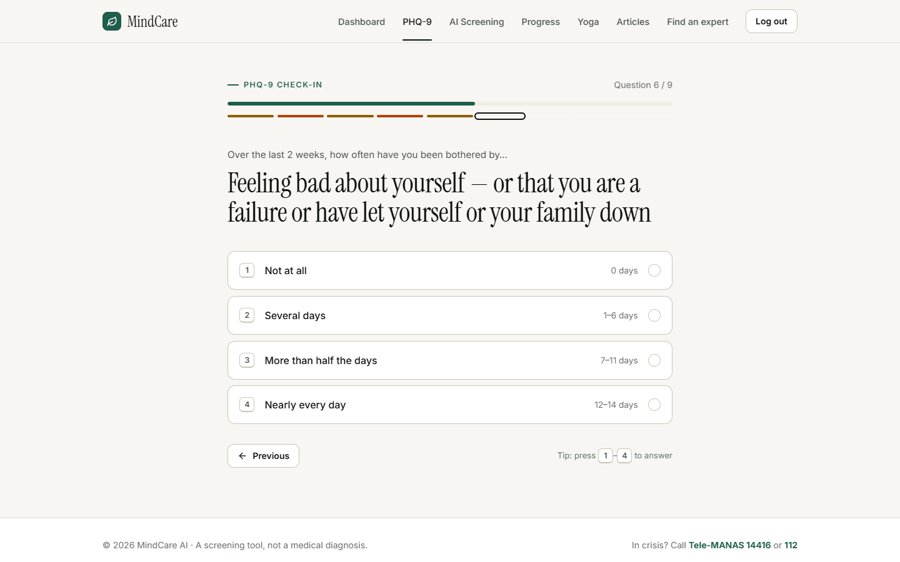
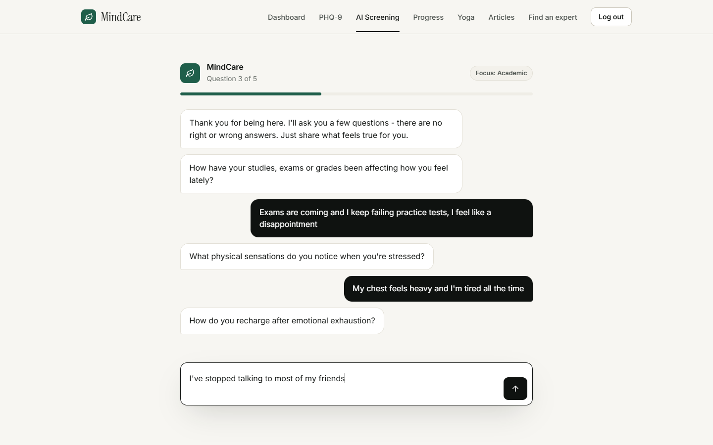
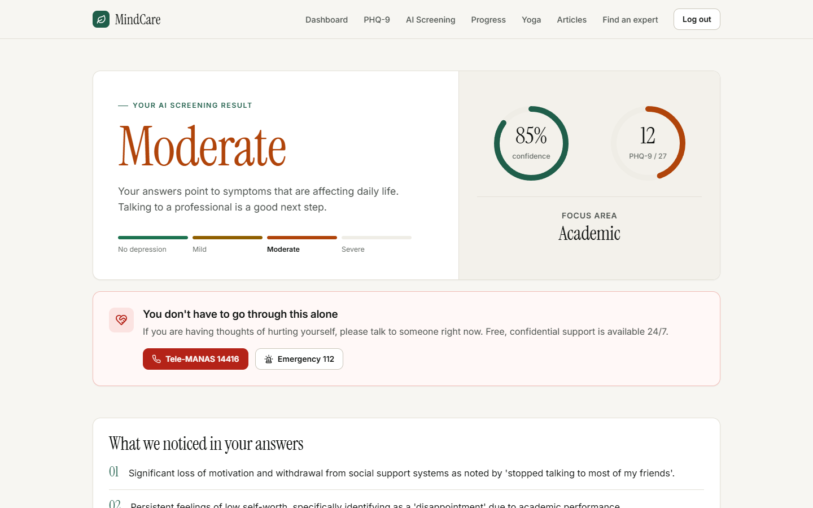
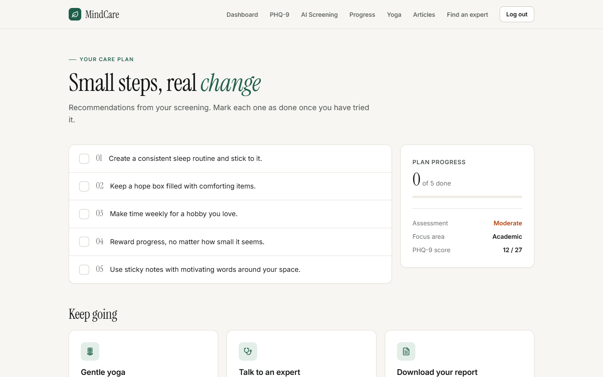
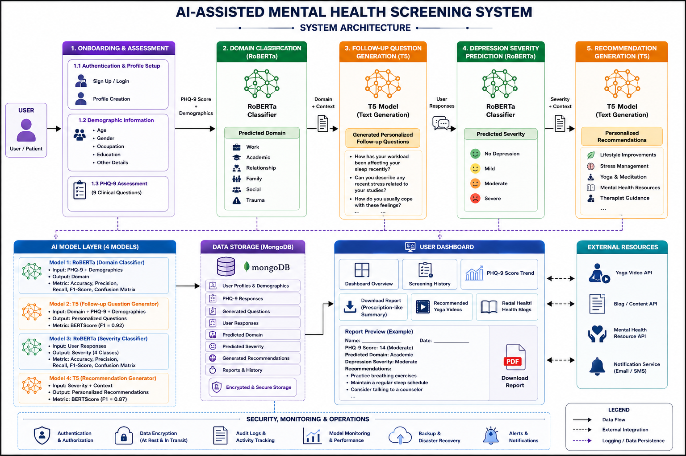
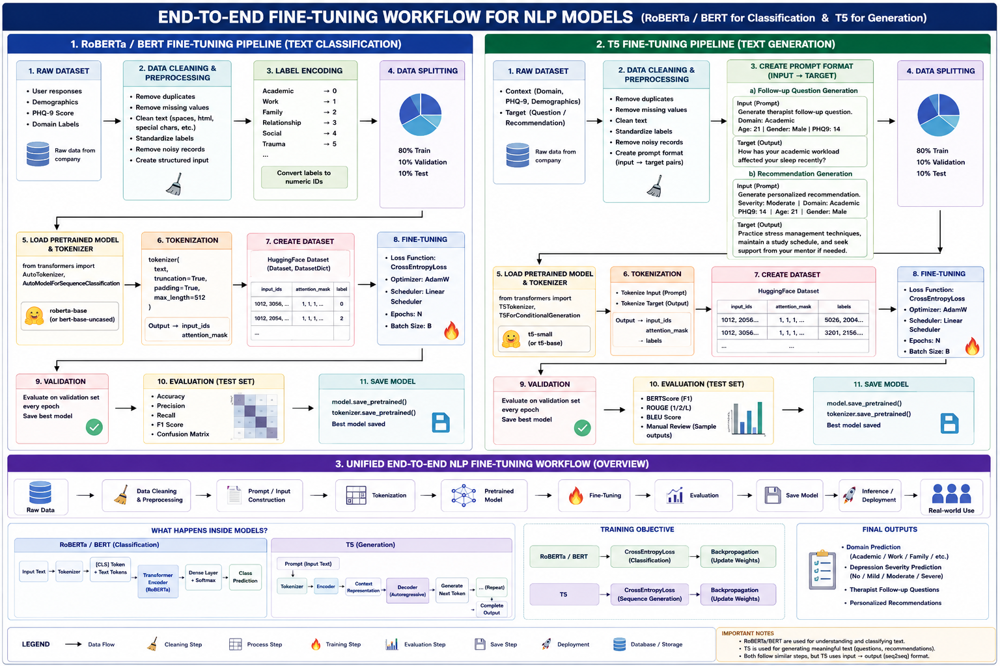

<p align="center">
  
</p>

<p align="center">
  
  
  
  
  
  
</p>

**MindCare AI** is an AI-assisted depression screening platform. A user takes the clinically validated
**PHQ-9** questionnaire, a fine-tuned **RoBERTa** model identifies the area of life affecting them most,
a fine-tuned **T5** model holds a short personal follow-up conversation, and the user's own answers are
assessed to produce a depression level, a personalised care plan and a downloadable report.

> [!IMPORTANT]
> MindCare AI is a **screening tool, not a medical diagnosis**. If you or someone you know is in crisis in
> India, call the **Tele-MANAS** helpline **14416** (24/7, free) or emergency services on **112**.

---

## How it works

<p align="center">
  
</p>

| Step | What happens | Powered by |
|---|---|---|
| **1. PHQ-9** | 9 clinically validated questions about the last two weeks (score 0–27) | Standard PHQ-9 |
| **2. Focus area** | Classifies the user into one of 6 domains: Academic, Work, Family, Relationship, Social, Trauma | Fine-tuned **RoBERTa** |
| **3. Conversation** | Generates personal follow-up questions; the user answers in their own words in a chat | Fine-tuned **T5** (+ one curated domain question) |
| **4. Assessment** | Reads the question–answer pairs and returns *No depression / Mild / Moderate / Severe* with confidence and key indicators | Trained model slot → **Gemini** → PHQ-9 cut-offs (fallback chain) |
| **5. Care plan** | Personalised suggestions, PDF report, progress tracking, yoga videos and expert directory | Fine-tuned **T5** |

Thoughts of self-harm (PHQ-9 item 9) or a *Severe* result always surface a crisis-support card.

## Screenshots

| Home | Dashboard |
|---|---|
|  |  |
| **PHQ-9 check-in** | **AI screening conversation** |
|  |  |
| **Screening result** | **Care plan** |
|  |  |

The UI is a light, high-contrast design system (Instrument Serif + Inter, a single deep-green accent,
Lucide icons) with restrained motion built on Framer Motion: page transitions, scroll reveals, count-up
numbers, animated score gauges, a typing indicator in the chat and a guided breathing exercise. It respects
the operating system's *reduce motion* setting and works down to phone width.

## System architecture

<p align="center">
  
</p>

```
React (localhost:3000) ──► Express API (localhost:5000) ──► Flask AI engine (localhost:5001)
                                   │                                │
                                   ▼                                ├─ RoBERTa domain classifier
                             MongoDB Atlas                          ├─ T5 question generator
                                                                    ├─ T5 suggestion generator
                                                                    └─ Gemini (depression level)
```

## Model training

<p align="center">
  
</p>

| Model | Base | Task | Input format |
|---|---|---|---|
| Domain classifier | `roberta-base` | 6-class sequence classification | `PHQ-9 responses: [...]. Mental health history: ... Occupation: ... Age: ...` |
| Question generator | `t5-small` | seq2seq | `phq1:2 phq2:1 ... history: ... domain: ... occupation: ... age: ...` → `Q1: ... \|\| Q2: ...` |
| Suggestion generator | `t5-small` | seq2seq | profile + depression level → suggestions separated by `;` |

The depression-level step uses **Gemini 3.1 Flash-Lite** because the trained depression model produced
`nan` targets. Dropping a valid model into `ai-engine/models/depression_prediction/` makes it the primary
method automatically; invalid outputs are rejected and fall through to Gemini, then to PHQ-9 cut-offs.

## Tech stack

| Layer | Technology |
|---|---|
| Frontend | React 18, React Router 6, Framer Motion, Recharts, Lucide icons |
| Backend | Node.js, Express, Mongoose, JWT auth, bcrypt |
| AI engine | Python, Flask, PyTorch, Hugging Face Transformers, Google Gemini API |
| Database | MongoDB Atlas |

## Setup

### Prerequisites

- **Node.js 18+** and npm
- **Python 3.11 or 3.12**
- A **MongoDB Atlas** cluster (the free M0 tier is enough) with your IP in *Database & Network Access*
- A **Gemini API key** from [Google AI Studio](https://aistudio.google.com/app/apikey)
- The fine-tuned **model weights** (not stored in git - see step 2)

### 1. Clone

```bash
git clone https://github.com/ro-hit-10/AI_Based_Mental_Health_Screening.git
cd AI_Based_Mental_Health_Screening
```

### 2. Add the models

Model weights are too large for git. Place them so the folders look like this:

```
ai-engine/models/
├── domain_assignment/     config.json, model.safetensors, label_encoder.joblib
├── question_generation/   config.json, model.safetensors, spiece.model, tokenizer files
└── suggestion/            config.json, model.safetensors, spiece.model, tokenizer files
```

If you have access to the private Hugging Face model repo, you can download them in one go:

```bash
cd ai-engine
python -c "from huggingface_hub import snapshot_download; snapshot_download('ro-hit-10/mindcare-models', local_dir='models')"
```

### 3. Configure environment variables

Create **`backend/.env`**:

```env
PORT=5000
MONGO_URI=mongodb+srv://<user>:<password>@<cluster>.mongodb.net/<db>
JWT_SECRET=<any long random string>
# Optional - defaults to http://localhost:5001
AI_ENGINE_URL=http://localhost:5001
```

Create **`ai-engine/.env`**:

```env
GEMINI_API_KEY=<your Gemini API key>
# Optional - defaults to gemini-3.1-flash-lite
GEMINI_MODEL=gemini-3.1-flash-lite
```

The frontend works without configuration. To point it at another backend, create `frontend/.env` with
`REACT_APP_API_URL=http://localhost:5000`.

> `.env` files are git-ignored. Never commit API keys.

### 4. Install dependencies

```bash
# Backend
cd backend
npm install

# Frontend
cd ../frontend
npm install

# AI engine (CPU build of PyTorch)
cd ../ai-engine
python -m venv .venv
.venv\Scripts\activate          # macOS / Linux: source .venv/bin/activate
pip install -r requirements.txt
```

### 5. Run

Start each service in its own terminal:

```bash
# Terminal 1 - AI engine  → http://localhost:5001
cd ai-engine
.venv\Scripts\activate
python app.py

# Terminal 2 - Backend    → http://localhost:5000
cd backend
npm run dev

# Terminal 3 - Frontend   → http://localhost:3000
cd frontend
npm start
```

Open **http://localhost:3000**. The AI engine takes ~20 seconds to load its models; check it with
`http://localhost:5001/api/health`, which reports which models loaded and which method each step uses.

## API reference

<details>
<summary><b>Backend</b> (Express, port 5000) - all routes except auth need <code>Authorization: Bearer &lt;token&gt;</code></summary>

| Method | Route | Purpose |
|---|---|---|
| POST | `/api/auth/register` | Create an account |
| POST | `/api/auth/login` | Sign in, returns a JWT |
| GET | `/api/users/dashboard` | Dashboard data |
| POST | `/api/phq/submit` | Submit PHQ-9 answers, returns score and domain |
| GET | `/api/phq/history` | PHQ-9 history |
| POST | `/api/screening/start` | Generate follow-up questions |
| POST | `/api/screening/save` | Analyse answers, save the session |
| POST | `/api/screening/suggestions` | Regenerate suggestions |
| GET | `/api/screening/history` | Screening history |
| GET | `/api/reports/patient-data` | Full report for the latest session |

</details>

<details>
<summary><b>AI engine</b> (Flask, port 5001)</summary>

| Method | Route | Purpose |
|---|---|---|
| POST | `/api/phq9-submit` | Domain classification |
| POST | `/api/generate-questions` | Follow-up questions |
| POST | `/api/analyze-depression` | Depression level from question–answer pairs |
| POST | `/api/generate-suggestions` | Care-plan suggestions |
| POST | `/api/complete-screening` | Assessment + suggestions in one call |
| GET | `/api/health` | Model status and active methods |

</details>

## Project structure

```
├── frontend/            React app
│   └── src/
│       ├── pages/       Home, auth, dashboard, results, care plan, report, experts
│       ├── components/  PHQ-9, AI screening chat, progress, yoga, articles
│       ├── ui/          Design-system components (navbar, loader, score ring, motion)
│       └── styles/      theme.css (tokens + components), pages.css
├── backend/             Express API, Mongoose models, JWT auth
├── ai-engine/
│   ├── app.py           Flask API and screening logic
│   ├── inference.py     PyTorch / ONNX inference backends (for CPU hosting; not used by app.py yet)
│   ├── tools/           export_onnx.py - compress models for CPU hosting
│   └── models/          Fine-tuned weights (not in git)
└── docs/                README images and diagrams
```

## Deployment notes

Deployment configs are included but **not active**: `render.yaml` (backend), `frontend/vercel.json`
(frontend) and `ai-engine/Dockerfile` (AI engine). The AI engine needs roughly 1–2 GB of RAM, which is more
than free tiers such as Render's 512 MB provide. `ai-engine/tools/export_onnx.py` produces compressed ONNX
models (int8 T5, fp16 RoBERTa); in testing they ran in about 1 GB without PyTorch, which is still above
512 MB.

## Known limitations

- The domain classifier reaches about 35% accuracy on the project dataset with the current input format;
  its original training script (and exact input format) would be needed to restore the 80% reported in training.
- The T5 question generator tends to produce generic questions, so each session opens with one curated
  domain-specific question.
- The *Find an expert* directory contains sample listings for demonstration.

---

<p align="center"><sub>Built with care. If you are struggling, please reach out - you don't have to go through it alone.</sub></p>
